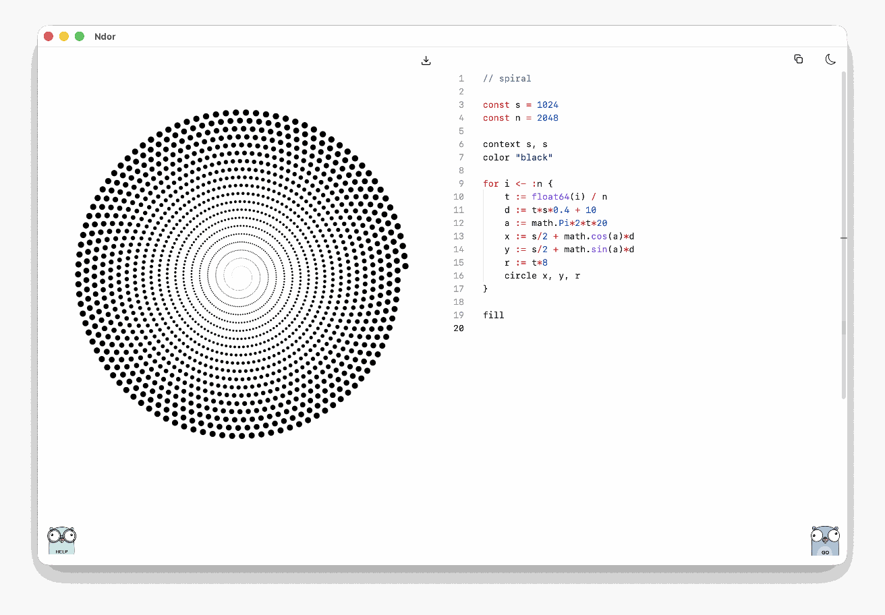

# ndor

`ndor` is an app with which you can draw by codes, for kids and coders~



## gui

A native GUI version built with [mygo](https://github.com/egoist/mygo).

## cli

Install with Go:

```shell
go install github.com/zrcoder/ndor/cmd/ndor@latest
```

Run:

```shell
ndor {source file}
```

> The argument is the code source file(xxx.xgo or xxx.md), the cli will generate a image as xxx.png or a html as xxx.html.

## develop

`ndor` is implemented with Go.

If you want to run `ndor` on your local machine：

1. Install `git`, `Go` and [`task`](https://taskfile.dev)
2. Clone the repo

   ```shell
   git clone https://github.com/zrcoder/ndor
   ```

3. Run
   - gui app:

     ```shell
     task gui
     ```

   - cli app

     ```shell
     task cli -- cmd/web/examples/rainbow.xgo
     task cli -- cmd/ndor/examples/hello.md
     ```
