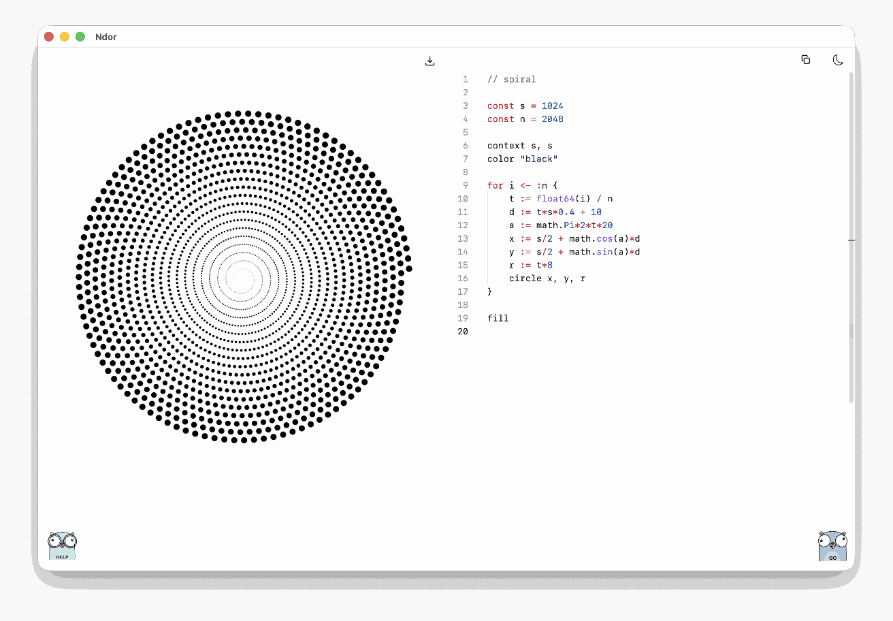

# ndor

[](https://awesomemygo.dev/apps/ndor)

`ndor` is an app with which you can draw by codes, for kids and coders~



It contains two drawing modules, both driven by code in [XGo](https://xgo.dev) or Go:

- **ndor** — free drawing with a canvas and a shape/path API (`circle`, `rectangle`, `bezier`, `fill`, `stroke`, colors, text, transforms...).
- **turtle** — turtle graphics on a grid, where a turtle moves with `step`, `left`/`right`, `pen`, `color` and `width`, and the drawing is animated stroke by stroke.

## gui

A native GUI version built with [mygo](https://github.com/egoist/mygo), with one window per module. Switch between `ndor` and `turtle` from the **Window** menu.

## cli

The CLI generates images for the **ndor** module.

Install with Go:

```shell
go install github.com/zrcoder/ndor/cmd/ndor@latest
```

Run:

```shell
ndor {source file}
```

> The argument is the code source file(xxx.xgo or xxx.md), the cli will generate a image as xxx.png or a html as xxx.html.

## develop

`ndor` is implemented with Go.

If you want to run `ndor` on your local machine：

1. Install `git`, `Go` and [`task`](https://taskfile.dev)
2. Clone the repo

   ```shell
   git clone https://github.com/zrcoder/ndor
   ```

3. Run
   - gui app:

     ```shell
     task gui
     ```

   - cli app

     ```shell
     task cli -- cmd/web/examples/rainbow.xgo
     task cli -- cmd/ndor/examples/hello.md
     ```
